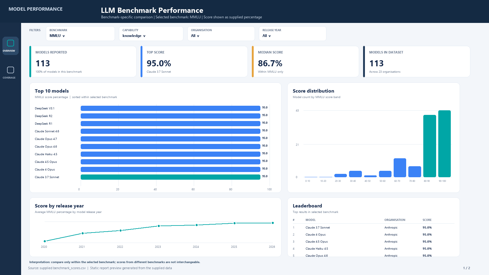
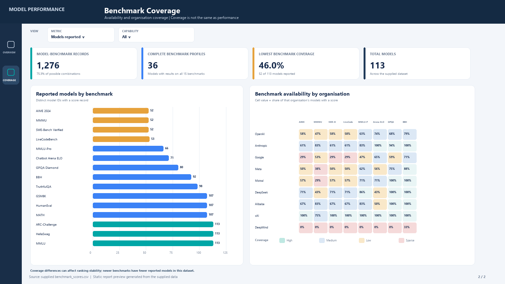

# LLM Benchmark Performance Explorer

A reproducible portfolio project for exploring model benchmark scores across capabilities, organizations and release dates. It includes a Python validation and summary pipeline plus a Power BI build kit with Power Query, DAX measures and a report specification.

## Project question
How do reported language-model benchmark scores vary by capability, organization and release date, and where is benchmark coverage sparse?

## Dataset
`data/benchmark_scores.csv` is the file supplied for this project. It contains 1,276 rows, 113 model IDs, 23 organizations and 15 benchmarks. Scores span release dates from 2020-02-13 to 2026-05-15. The dataset has no source citation or collection methodology, so the project treats it as an unverified portfolio dataset and makes no claims that it is a current or authoritative leaderboard.

Each row is one model/benchmark result. `score_pct` is the supplied score divided by `max_score`, expressed as a percentage. This arithmetic normalization is useful as a display field but does not make different benchmarks interchangeable. In particular, Chatbot Arena ELO is a rating scale; comparisons and rankings should remain within the same benchmark.

## Reproduce the summary tables
Python 3.10+; no third-party packages are required.

```bash
python analyze.py
```

The script validates required columns, numeric bounds, duplicate model/benchmark keys and the supplied percentage calculation. It writes top-three results within each benchmark to `outputs/benchmark_leaders_top3.csv` and reported-model counts to `outputs/benchmark_coverage.csv`.

## Dashboard previews

The static report previews below are rendered from the supplied CSV and included in `powerbi/screenshots/`. They illustrate the intended Power BI layout and use the dataset's actual values. They are preview images, not screenshots captured from Power BI Desktop.




## Power BI
See [`powerbi/README.md`](powerbi/README.md) for import steps, Power Query, DAX measures, model relationships and report layout.

## Initial findings

- The dataset has 1,276 of 1,695 possible model-benchmark records (75.3% coverage); 36 of 113 models have results for all 15 benchmarks.
- Coverage ranges from 52 reported models (46.0%) on MMMU, AIME 2024 and SWE-Bench Verified to all 113 models on MMLU, HellaSwag and ARC-Challenge.
- The sparse coverage on several newer benchmarks means cross-benchmark leader tables represent different model populations. Read each ranking with its coverage count.
## Suggested questions
- Which model leads each selected benchmark?
- How much does benchmark coverage vary across the 113 models?
- How do benchmark scores change across release cohorts, when viewed within a single benchmark?
- Which organizations have the most reported rows, and how does that count differ from the number of models?

## Interpretation guardrails
- Compare models only within the same benchmark and compatible evaluation conditions.
- Do not average `score_pct` across benchmarks to create an overall model score.
- Benchmark availability is uneven; rankings may reflect which models were reported, not the full market.
- The supplied file does not include test-set versions, evaluation dates, confidence intervals or source references.
- Model release date is not necessarily the benchmark measurement date.


